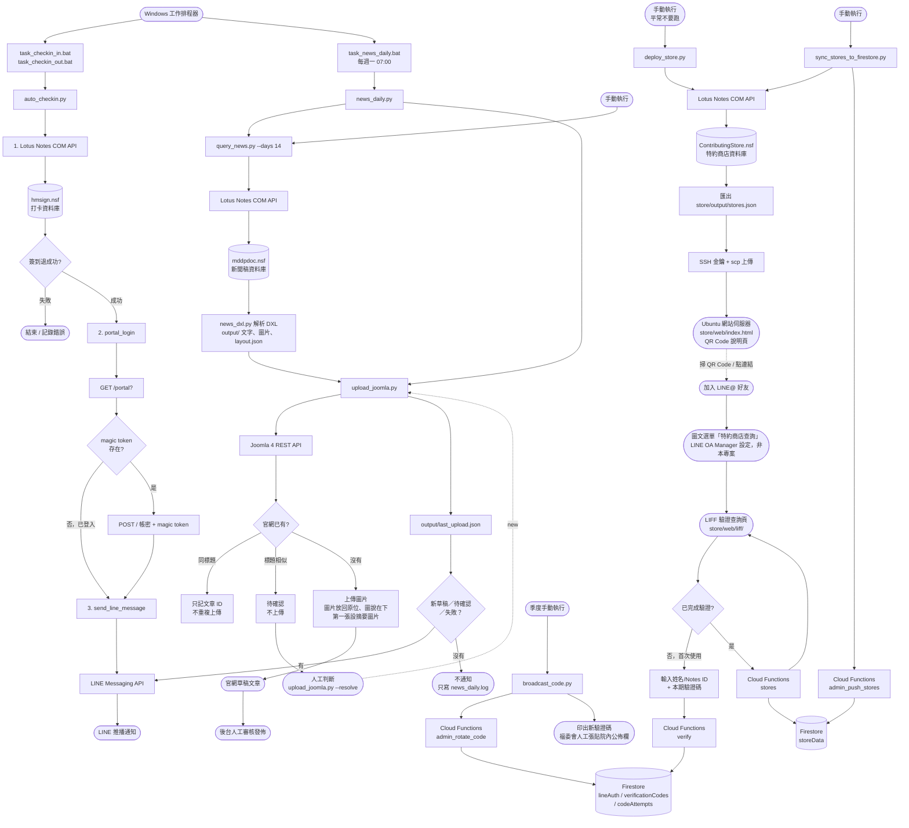

# autowork-lotusNotesCOM - Lotus Notes 自動化工具

透過 Lotus Notes COM API 操作院內 Notes 資料庫的自動化工具集，目前有六項功能：

- **功能一・打卡**：執行簽到/簽退，過程中順便完成院內 Portal 上網認證，並用 LINE 推播打卡結果通知。
- **功能二・新聞稿擷取**：從 Notes 資料庫擷取新聞稿內容與圖片，存到本機
- **功能三・上傳至 Joomla**：把擷取到的新聞稿透過 REST API 上傳到 Joomla 4 官網，存成草稿文章（圖片放回原位、圖說在下、自動設摘要圖片）；上傳前查重，標題相似的列為待確認。**每週一 07:00 排程自動跑**，有新草稿或待確認時用 LINE 通知
- **功能四・特約商店查詢頁**：從 Notes 資料庫匯出特約商店優惠清單，部署成一個**限本院同仁使用**的查詢頁；同仁透過 LINE 官方帳號（LINE@）加好友、在 LIFF 頁完成身分綁定驗證後即可查詢，後端為 Firebase Cloud Functions + Firestore
- **功能五・福利公告查詢**：從院內公佈欄匯出職工福利行政小組發布的公告（含圖片），部署成另一個限本院同仁使用的查詢頁，跟功能四共用同一套 LINE 身分驗證，但公告資料存在 Ubuntu 網站伺服器，不進 Firebase
- **功能六・特約商店線上申請**：店家線上填表申請加入特約，職工福利小組審核通過後系統自動產生「特約商店同意書」PDF（2026-10 起由合約書改為同意書，只需店家核章），店家蓋章後可直接在網頁上傳或透過 LINE 官方帳號回傳掃描檔，取代原本純電話/Email 聯繫的方式，詳見 `sdd5.md`

各功能的詳細說明見下方對應章節。

---

## 系統流程圖

> 下圖涵蓋功能一～五。功能六（特約商店線上申請，含表單、審核、同意書套版、LINE 綁定與用印回傳）自成一套較複雜的流程，畫在 `sdd5.md` 開頭的流程圖裡，不重複畫在這裡。



---

## 系統需求

| 項目 | 需求 |
|---|---|
| 作業系統 | Windows（僅限，依賴 COM API） |
| Python | 3.x **32-bit**（配合 Lotus Notes 8.5.3 32-bit） |
| Notes 用戶端 | HCL Notes 12（32-bit，原為 Lotus Notes 8.5.3，2026-09 換機後改用），執行腳本時用戶端**需關閉**，見「注意事項」 |
| 虛擬環境 | `venv32`（32-bit Python） |

---

## 安裝

```powershell
# 建立 32-bit 虛擬環境（使用 32-bit Python 執行檔）
& "C:\path\to\python32\python.exe" -m venv venv32

# 安裝套件
venv32\Scripts\pip.exe install pywin32 python-dotenv requests beautifulsoup4
```

---

## 環境設定（`.env`）

在專案根目錄建立 `.env`：

```
NOTES_PASSWORD=你的Notes密碼

JOOMLA_URL=https://你的網站網址/home
JOOMLA_TOKEN=你的JoomlaAPIToken
JOOMLA_CATEGORY_ID=8
JOOMLA_MEDIA_FOLDER=images/01news

PORTAL_URL=https://hltchnet.tzuchi.com.tw:1003/
PORTAL_USERNAME=你的員工編號
PORTAL_PASSWORD=你的密碼

LINE_CHANNEL_TOKEN=你的channel_access_token
LINE_USER_ID=你的line_user_id
```

> `.env` 已列入 `.gitignore`，不會被 git 追蹤。

---

## 功能一：打卡（`auto_checkin.py`）

執行流程：
1. **Lotus Notes 簽到／退** — 寫入 `hmsign.nsf`
2. **Portal 登入** — POST 至院內上網認證頁面，取得對外網路
3. **LINE 通知** — 推播完成訊息給自己

```powershell
# 簽到
venv32\Scripts\python.exe auto_checkin.py in

# 簽退
venv32\Scripts\python.exe auto_checkin.py out
```

**設定區（`auto_checkin.py` 頂部）：**

| 變數 | 說明 | 預設值 |
|---|---|---|
| `SERVER` | Domino 伺服器 | `hladmin2/medicine/Tzuchi` |
| `DB_PATH` | 打卡資料庫路徑 | `moghuman\hmsign.nsf` |
| `USER` | Notes 使用者名稱 | `曾建瑋/medicine/Tzuchi` |
| `SIGN_TYPE` | 班別代碼 | `N`（正常班） |

班別代碼：`N`=正常班　`A`=加班　`C`=OnCall　`S`=交接班

**日誌：** `checkin.log`

### 放假日跳過打卡

在專案根目錄的 `holidays.txt` 中，一行寫一個日期（格式 `YYYY-MM-DD`，`#` 之後視為註解），若執行當天的日期出現在清單中，`auto_checkin.py` 會**整個流程都跳過**（不打卡、不登入 Portal、不發 LINE 通知），僅在 `checkin.log` 留下一筆紀錄。

```
# holidays.txt 範例
2026-08-21          # 特休
2026-10-10          # 國慶日
```

`holidays.txt` 不存在或內容為空時，視為沒有放假日，照常執行打卡（不會報錯）。此檔案已列入 `.gitignore`，不會被 git 追蹤。

### LINE Messaging API 設定

1. 至 [LINE Developers](https://developers.line.biz/) 建立 Messaging API Channel
2. Basic settings → **Your user ID** → 填入 `.env` 的 `LINE_USER_ID`
3. Messaging API → **Channel access token** → 產生並填入 `.env` 的 `LINE_CHANNEL_TOKEN`

### Portal 登入說明

- 使用 `http.client` 直接發送 HTTPS 請求（繞過 urllib3 的 ALPN/HTTP2 協商，與院內 pfSense portal 相容）
- 流程：GET 取得 CSRF magic token → POST 送出帳密
- 若 Portal 已登入，自動跳過 POST

### Windows 工作排程器

| 批次檔 | 用途 |
|---|---|
| `task_checkin_in.bat` | 排程簽到（建議設定 08:00） |
| `task_checkin_out.bat` | 排程簽退（建議設定 17:00） |
| `task_news_daily.bat` | 新聞稿自動上稿（`news_daily.py --days 14`，見「功能三」）；排程名稱「新聞稿每週自動上稿」（工作排程器 autowork 資料夾），**每週一 07:00**。要排在 Notes 用戶端沒開的時段，且不要跟打卡同一時間 |

設定方式：工作排程器 → 建立基本工作 → 觸發程序選「每天」→ 動作選「啟動程式」→ 選擇對應 `.bat` 檔。

---

## 功能二：新聞稿擷取（`query_news.py`）

連線至 `mddpdoc.nsf`，依日期區間下載新聞稿文字與內嵌圖片。

```powershell
venv32\Scripts\python.exe query_news.py
```

執行後輸入起訖日期：

```
起始日期 (YYYY/MM/DD): 2026/05/01
結束日期 (YYYY/MM/DD): 2026/05/31
```

**輸出結構：**

```
output/
├── checklist.json              ← 下載紀錄（防重複下載）
├── 20260506_新聞標題/
│   ├── content.txt             ← 文字內容（純文字，body.Text 會在句中硬斷行，僅供人看）
│   ├── layout.json             ← 段落與圖片在 Notes 中的先後順序（news_dxl.py 產生，上傳排版用）
│   ├── img_000.jpg             ← 依文件中出現的順序編號
│   └── img_001.jpg
└── 20260513_另一篇新聞/
    └── ...
```

**重複下載防護：**
- 已下載的文章會記錄在 `output/checklist.json`
- 再次執行同樣日期區間時，已下載的文章會自動跳過
- 若要強制重新下載，刪除 `checklist.json` 中對應的 UNID 記錄即可

---

## 功能三：上傳至 Joomla（`upload_joomla.py`）

將 `query_news.py` 下載的新聞稿上傳至 Joomla 4 網站，建立草稿文章。

```powershell
venv32\Scripts\python.exe upload_joomla.py            # 正式上傳
venv32\Scripts\python.exe upload_joomla.py --dry-run  # 只查重、列出會做什麼，不上傳
```

- **查重**：上傳前先用標題查官網，已經有的（例如已人工上稿）只把官網文章 ID 記進 `checklist.json`（`joomla_existing: true`），不重複上傳；標題會先去掉 Notes 的日期編號 `17/` 與作者括號 `(曾定嘉)`
- **不上傳的文章**：在 `output/checklist.json` 該篇加上 `"joomla_skip": "原因"`（例如人醫心傳雜誌內容）
- 任一張圖片上傳失敗就不建立該篇文章，下次重跑整篇重來
- **排版**（比照人工上稿）：依 `layout.json` 把圖片放回 Notes 原本的位置、同一排的圖片放同一段，圖說接在圖片下方（多行用 `<br />` 合併）；段落完整不會句中斷行、去掉段首全形空白；不放標題、「紀錄:」、「撰文者」「報導」行。沒有 `layout.json` 的舊下載才退回「純文字 + 圖片放文末」
- **摘要圖片**：第一張圖自動設為文章的摘要圖片（「圖片與連結」分頁），全文圖片留空
- **要重新上傳已建立的草稿**：API 不能修改或刪除文章（伺服器只放行建立），請到後台把草稿移到垃圾桶並清空，再把 `checklist.json` 該篇的 `joomla_id`、`joomla_uploaded_at` 刪掉後重跑

**前置條件（Joomla 後台）：**（中文語言包會把外掛名稱翻成「網路服務 - …」，用類型篩選比較好找；Joomla 4/5 核心**沒有** `System - Web Services` 這個外掛）
1. 外掛類型 `api-authentication`：啟用「API 認證 - Joomla Token」（`token`）
2. 外掛類型 `user`：啟用「會員 - Joomla API Token」（`token`），Token 所屬帳號須在允許群組內（預設 Super Users）
3. 外掛類型 `webservices`：啟用「網路服務 - 內容」（`content`）與「網路服務 - 媒體」（`media`）
4. Users → 你的帳號 → Joomla API Token → 產生 Token 並填入 `.env`

**前置條件（網站伺服器 Apache）：**
- `/etc/apache2/conf-available/security.conf` 的「1. 封鎖 Joomla API（CVE-2023-23752）」預設擋掉所有 `/api/.../v1/` 請求；目前只開放執行上傳的電腦 `10.16.92.34`，而且只能用 `content/articles`、`media/files` 兩支 API（2026/10/12 加入）。換電腦或 IP 變動時要改這裡的 `Require ip`
- Token 必須用 `X-Joomla-Token` 標頭送：Apache 會把 `Authorization: Bearer` 標頭吃掉，Joomla 收不到就回 401
- ModSecurity（OWASP CRS）會把文章 HTML／圖片 base64 誤判成 XSS/RCE 而回 403，已在 `/etc/modsecurity/joomla-waf-rules.conf` 對同一台電腦＋同兩支 API 設例外（rule id 1000100，只放行建立文章 `content/articles` 與上傳圖片 `media/files`，不含修改單篇文章）。注意 `crs-exclusions.conf`、`crs-whitelist.conf` 沒被 `security2.conf` 載入，加在那裡無效。換電腦或 IP 時這裡也要一起改
- 伺服器擋 `DELETE` 方法（API 刪不了檔案），測試檔要上伺服器手動刪

**圖片上傳路徑規則：**（Media API 實際送出的是 `local-images:/01news/...`，`local-images` 的根目錄就是 `images/`，直接送 `images/...` 會被存成 `images/images/...`）

```
images/01news/{年}/{月}/{月日}/{UNID前8碼}/img_000.jpg
```

範例：2026/05/13 的新聞稿（UNID 開頭 `BCE1730B`）：
```
images/01news/2026/05/0513/BCE1730B/img_000.jpg
```

**文章狀態：** 上傳後為**草稿（Unpublished）**，需至後台審核後手動發佈。

### 每日自動上稿（`news_daily.py`，排程用）

```powershell
venv32\Scripts\python.exe news_daily.py                   # 擷取最近 7 天 → 上傳 → 有結果才發 LINE
venv32\Scripts\python.exe news_daily.py --always-notify   # 沒有新文章也發 LINE（測試通知用）
```

1. `query_news.py --days 7`：擷取最近 7 天的新聞稿（已下載的自動跳過）
2. `upload_joomla.py`：官網沒有的建成草稿；官網已有同標題的只記 ID；**標題相似**（人工上稿時改過標題，相似度 ≥ 0.6 且建立日期在前後 30 天內）的列為**待確認**，不上傳
3. 有新草稿、待確認、失敗或錯誤時，LINE 推播給 `.env` 的 `LINE_USER_ID`；完整過程寫在 `news_daily.log`

**處理待確認**（LINE 通知裡會附指令，也可以用 `menu.py` →「處理待確認的新聞稿」）：
```powershell
venv32\Scripts\python.exe upload_joomla.py --resolve C9B8D5D8 new    # 不同篇：下次排程照常上傳
venv32\Scripts\python.exe upload_joomla.py --resolve C9B8D5D8 4701   # 同一篇：記下官網文章 ID，不上傳
```

**排程注意事項：**
- 排程用 `task_news_daily.bat`，目前設定**每週一 07:00**、擷取最近 **14 天**（每週跑一次只抓 7 天會漏掉上週一 07:00 之後才建立的稿；重疊的部分已下載會自動跳過）
- 排程是「使用者登入時才執行」，週一 07:00 電腦沒開或沒登入就會跳過這週，下週的 14 天範圍會補抓
- **HCL Notes 用戶端開著時會被鎖住而擷取失敗**（LINE 會通知「請關閉 HCL Notes 用戶端」），排程時間要避開有人用這台電腦的時段
- 失敗的文章不會標記為已上傳，下次排程自動重試

---

## 功能四：特約商店查詢頁（`store/`）

從 `ContributingStore.nsf` 匯出未作廢、未過期的特約商店清單，部署成一個給院內同仁用手機查詢的網頁。**查詢頁已上線存取控制**（見下方「特約商店查詢頁存取控制」）：`store/web/index.html` 現在是一個說明頁面，附上加入 LINE@ 好友的 QR Code 跟連結；同仁加好友後透過圖文選單進入 LIFF 查詢頁，實際查詢資料只能透過 LINE 登入 + 驗證碼綁定後取得。

> **`store/deploy_store.py` 平常不要再執行**：這支腳本會把 `stores.json`（完整店家資料）跟其他靜態頁面一起 scp 到正式站，一旦跑了就會讓 `stores.json` 重新變成任何人都能直接用網址抓取的公開檔案，等於繞過剛做好的存取控制。目前只保留這支腳本的原始碼與說明供參考／未來需要時查閱，日常更新特約商店清單一律改用下面的 `sync_stores_to_firestore.py`。若真的需要重跑 `deploy_store.py`（例如要更新 `join.html`/`qa.html`/`style.css` 這些靜態頁），跑完務必手動把正式站上的 `stores.json` 刪掉。

```powershell
venv32\Scripts\python.exe store\deploy_store.py
```

流程：匯出最新 `store/output/stores.json` → 透過 SSH 金鑰用 `scp` 把 `store/web/`（`index.html`、`join.html` 加入特約、`qa.html` 常見問題、`style.css` 共用樣式）與 `stores.json` 上傳到 Ubuntu 網站伺服器的 `STORE_REMOTE_PATH`。

**這支腳本目前必須手動執行**（不走排程）：因為這台機器的 Notes ID 沒有開放「允許其他 Notes 程式使用此密碼」，`Initialize()` 會跳出互動式密碼輸入視窗，需要在畫面上手動輸入密碼才能繼續，無法無人值守跑排程。之後如果想改成排程，要先在 Notes 用戶端的 **File → Security → User Security** 把該選項打開。

**`.env` 需要的欄位：**

```
SFTP_HOST=10.2.116.138
SFTP_PORT=22
SFTP_USER=你的SSH帳號
SFTP_KEY_PATH=C:\Users\peter\.ssh\tzuchi_store_deploy
STORE_REMOTE_PATH=/var/www/html/store
```

金鑰登入需要先把 `store/deploy_store.py` 用的公鑰（`%USERPROFILE%\.ssh\tzuchi_store_deploy.pub`）加到 Ubuntu 伺服器該帳號的 `~/.ssh/authorized_keys`。

**為什麼用 SSH 金鑰而不是 `paramiko`？** 這台機器是 Python 3.14（32-bit），`paramiko` 依賴的 `cryptography` 目前在 PyPI 上還沒有 cp314-win32 的預編譯 wheel，會退回原始碼建置並卡在院內網路的 SSL 憑證攔截。改用 Windows 內建的 OpenSSH 用戶端（`ssh.exe` / `scp.exe`）不用額外裝套件，也剛好符合排程需要非互動式登入（金鑰）的需求。

### 特約商店查詢頁存取控制（已上線）

完整設計見 `sdd3.md` §5。同仁掃 LINE@ QR code 加好友、點選圖文選單「特約商店查詢」，第一次使用會在 LIFF 頁輸入姓名/Notes ID + 院內公佈欄公告裡的本期驗證碼完成綁定，之後查詢優惠都透過這個 LINE@ 進行，不用重複驗證。後端是 Cloud Functions（Python）+ Firestore（專案 `hlwelfare`），本機這台機器完全不持有 Firebase 憑證，只用共用密鑰打 Cloud Functions 的 admin 端點——見 `firebase/` 目錄與下方新增的工具腳本。

已完成並實測：Cloud Functions 五支端點（`verify`／`stores`／`admin_push_stores`／`admin_rotate_code`／`admin_import_roster`）部署上線、`store/web/liff/index.html` 部署上線、真實 LINE 帳號走完「加好友 → 輸入姓名+驗證碼 → 查詢」全流程、`store/web/index.html` 正式切換成附加入 LINE@ 好友 QR Code 的說明頁（圖文選單「特約商店查詢」已在 LINE Official Account Manager 設定好連到 LIFF 頁，非本專案程式碼處理）、正式站殘留的公開 `stores.json` 已刪除。

**重新部署 Cloud Functions（改程式碼後才需要）：**

```powershell
cd firebase
firebase deploy --only functions
```

如果改到 `firestore.rules`/`firestore.indexes.json`，記得加上 `firestore:rules,firestore:indexes`。secrets（`ADMIN_SHARED_SECRET`、`LINE_LOGIN_CHANNEL_ID`、`BULLETIN_SECRET_SLUG`、`LINE_CHANNEL_SECRET`、`LINE_CHANNEL_ACCESS_TOKEN`）已經設定在 Cloud Functions 那端，改密鑰才需要重跑 `firebase functions:secrets:set 密鑰名稱`。

**`firebase/functions/.env`（部署 Cloud Functions 用，跟著程式碼一起部署，不是 secret）：**

```
ALLOWED_ORIGIN=https://hlm.tzuchi.com.tw
BULLETIN_BASE_URL=（Ubuntu 網站伺服器上，公告 JSON 所在目錄的網址前綴，見「功能五」）
STORAGE_BUCKET_NAME=hlwelfare.firebasestorage.app
```

> 這個變數不能叫 `FIREBASE_STORAGE_BUCKET`——`firebase deploy` 會拒絕 `.env` 裡以 `FIREBASE_`／`X_GOOGLE_`／`EXT_`／`KIT_` 開頭的變數名稱（保留字首），實測部署失敗才改名為 `STORAGE_BUCKET_NAME`。

**`.env`（根目錄，本機腳本用，不含任何 Firebase 憑證）：**

```
STORE_AUTH_FUNCTIONS_BASE_URL=https://us-central1-hlwelfare.cloudfunctions.net
ADMIN_SHARED_SECRET=（要跟 Cloud Functions 那端 ADMIN_SHARED_SECRET secret 的值一致）
LIFF_ID=2011285225-tzE9fFFl
STORE_LIFF_URL=https://liff.line.me/2011285225-tzE9fFFl
```

**例行操作：**

```powershell
# 把最新特約商店清單同步到 Firestore（給 LIFF 查詢頁用，取代 deploy_store.py 平常的角色）
venv32\Scripts\python.exe store\sync_stores_to_firestore.py

# 換一組新的期效性驗證碼並印出來（季度執行）。公告本身透過院內另一個 Notes 公佈欄
# 資料庫人工張貼，不是本專案程式碼處理的範圍。第一個參數是部門/情境名稱，純粹自己
# 追蹤用，不同名稱各自獨立換碼、互不影響。
venv32\Scripts\python.exe store\broadcast_code.py 職工福利小組

# 季度在職名單覆核：先 dry-run 看報告，確認沒問題再加 --commit 真的撤銷
venv32\Scripts\python.exe store\import_roster.py 名單.csv
venv32\Scripts\python.exe store\import_roster.py 名單.csv --commit

# 把 LIFF 驗證頁部署到 Ubuntu 主機（改了 store/web/liff/index.html 才需要重跑）
venv32\Scripts\python.exe store\deploy_liff.py
```

**尚未完成**（見 `sdd3.md` §9、§10）：連續打錯驗證碼會不會真的鎖定，還沒有拿真實 Firestore 環境測過（需要一個尚未驗證過的 LINE 身分才能測）；季度在職名單真實欄位格式尚未確認。

---

## 功能五：福利公告查詢（`bulletin/`）

從院內公佈欄（`mdabulletin.nsf`）匯出「職工福利行政小組」發布、尚未過期的公告（含內嵌圖片），部署一個限本院同仁使用的查詢頁。跟特約商店查詢頁共用同一套 LINE@ + LIFF 身分驗證（sdd3.md §5），但公告資料**不進 Firebase**，存在 Ubuntu 網站伺服器一個沒有任何頁面連結、路徑是亂碼的目錄下——Cloud Functions 的 `bulletin` 端點驗證身分通過後才代替使用者去抓那個網址，詳見 `sdd4.md`。

```powershell
venv32\Scripts\python.exe bulletin\deploy_bulletin.py
venv32\Scripts\python.exe store\deploy_liff.py
```

**`.env` 新增欄位：**

```
BULLETIN_SECRET_SLUG=（存取控制用的隨機路徑，本機跟 Cloud Functions 的 secret 要一致）
BULLETIN_LIFF_ID=（bulletin.html 專用的第二個 LIFF app ID，見下方說明）
```

**圖文選單設定注意事項 / 為什麼 bulletin.html 需要自己的 LIFF app**：一開始曾經想讓「福利公告查詢」共用特約商店查詢頁那組 `LIFF_ID`，直接連完整網址 `https://hlm.tzuchi.com.tw/store/liff/bulletin.html` 繞過短網址（因為一個 LIFF ID 只能登記一個 Endpoint URL，短網址 `https://liff.line.me/{LIFF_ID}` 固定指向特約商店查詢頁）。**這個做法實際上行不通**：LIFF SDK 會把用完整網址直接開啟的頁面判斷成「外部瀏覽器」（`liff.isInClient()` 是 `false`），沒辦法沿用 LINE App 本身的登入狀態，會一直卡在「LINE 登入狀態已失效」，重灌 LINE、清快取、刪 Firestore 綁定紀錄都沒用。

正確做法是在 LINE Developers Console **同一個 LINE Login Channel** 底下另外建立第二個 LIFF app，Endpoint URL 設成 `https://hlm.tzuchi.com.tw/store/liff/bulletin.html`，把拿到的 LIFF ID 填進 `.env` 的 `BULLETIN_LIFF_ID`，圖文選單的「福利公告查詢」按鈕改連這組新 LIFF app 的短網址 `https://liff.line.me/{BULLETIN_LIFF_ID}`。因為兩個 LIFF app 是同一個 Channel，`verify_line_id_token()` 驗證出來的 `sub`（LINE 使用者 ID）相同，Firestore 的驗證綁定狀態（`lineAuth/{sub}`）兩邊共用，同仁不需要分別驗證兩次。

**同時同步特約商店 + 福利公告**：Lotus 資料兩邊都更新完，不想分兩次下指令的話可以用根目錄的 `sync_all.py`，一次跑完 `store/sync_stores_to_firestore.py` + `bulletin/deploy_bulletin.py`：

```powershell
venv32\Scripts\python.exe sync_all.py
```

---

## 功能六：特約商店線上申請（`store/`，見 `sdd5.md`）

取代原本 `store/web/join.html` 純聯絡資訊頁的做法：店家在 `store/web/apply.html` 線上填表申請加入特約（含優惠內容、優惠適用期間「長期有效／至指定日期止」）；職工福利小組用 `apply_review.py` 互動式審核（含 §4.10 統一編號真實性查證），核准後 `generate_contracts.py` 把申請資料套進**特約商店同意書**產生 PDF；店家在同意書蓋上商店印鑑及代表人簽章後，直接回到 `apply_status.html` 同一頁上傳掃描檔即可（主要管道，見 `sdd5.md` §4.7.1），也可以改加入 LINE 官方帳號完成身分核對後在聊天視窗傳回，不用寄 Email；職工福利小組核對已蓋章就結案，**本院不用再用印、回傳最終檔案**。**Phase 1、Phase 2、Phase 3 都已部署到正式環境，核心流程用真實資料/真實 LINE 帳號驗收通過**（2026-09-14）；2026-10 起合約書改為同意書（`sdd5.md` §4.5.1），詳見 `sdd5.md` §7 各項勾選狀態。

```powershell
# 部署 apply.html / apply_status.html 到 Ubuntu 網站伺服器
venv32\Scripts\python.exe store\deploy_apply.py

# 互動式審核目前 pending 的申請
venv32\Scripts\python.exe store\apply_review.py

# 純瀏覽其他狀態的申請（不會進入審核提示）
venv32\Scripts\python.exe store\apply_review.py --status approved

# 一次性：把 template-consent.docx（同意書原稿）轉成含 {{...}} 佔位符的套版範本（同意書改版才需要重跑）
venv32\Scripts\python.exe store\prepare_consent_template.py

# 把已核准的申請套版產生同意書 PDF、上傳、回寫下載網址
venv32\Scripts\python.exe store\generate_contracts.py
```

**`.env` 新增欄位**（`generate_contracts.py` 用，組出同意書 PDF 對外的下載網址）：

```
STORE_PUBLIC_BASE_URL=https://hlm.tzuchi.com.tw/store
```

**Cloud Functions 新增端點**（`firebase/functions/main.py`）：`apply`（公開，店家送出申請）、`application_status`（公開，查詢進度）、`upload_signed_file`（公開，店家在查詢頁直接上傳蓋好章的同意書掃描檔，主要回傳管道，見 `sdd5.md` §4.7.1）、`download_file`（公開＋admin，下載店家自有合約書／用印回傳掃描檔）、`admin_list_applications`／`admin_review_application`／`admin_mark_contract_ready`／`admin_update_status`（admin-only，分別給 `apply_review.py`／`generate_contracts.py` 呼叫）、`line_webhook`（公開但驗證 LINE 簽章，處理店家 LINE 身分綁定與用印檔案接收，見下方）。這是本專案第一次用到 **Firebase Storage**（店家上傳的自有合約書、LINE 回傳的用印掃描檔都存在這裡，bucket 規則整個鎖死，只有 Admin SDK 能讀寫），`firebase/functions/.env` 需新增 `STORAGE_BUCKET_NAME`（原本想叫 `FIREBASE_STORAGE_BUCKET`，但 `firebase deploy` 會拒絕 `.env` 裡以 `FIREBASE_` 開頭的變數名稱，實測部署失敗才改名）。

**統一編號查證的已知限制**（`store/tax_id_lookup.py`，見 `sdd5.md` §4.10、§6）：「統編查公司名稱」（公司登記）實測免申請即可用；「商業統一編號查商號名稱」（商業/商號登記，特約商店裡更常見的類型）實測需要向經濟部申請 IP 白名單才能用，這台機器目前還沒申請，`apply_review.py` 審核時會清楚顯示「查證功能未開通」，不會誤判成「查無登記資料」。

### LINE 官方帳號身分綁定與用印回傳（`line_webhook`，已部署並實測通過）

> **回傳用印檔的主要管道是網頁上傳**（店家在 `apply_status.html` 查到「同意書已產生」後，直接在同一頁選檔案上傳，不需要再核對身分，見 `sdd5.md` §4.7.1）；下面的 LINE 綁定是選用的第二管道，頁面上收合在「也可以改用 LINE 傳回」。

店家核准後加入「花蓮職工福利行政小組」LINE 官方帳號，在聊天視窗輸入「申請編號 查詢碼」完成身分核對，之後直接在同一個對話傳回用印完成的掃描檔即可，不用寄 Email——詳見 `sdd5.md` §4.7、§4.8。

```powershell
# 職工福利小組人工核對店家回傳的同意書（商店印鑑、代表人簽章），確認後標記完成
venv32\Scripts\python.exe store\apply_review.py --status merchant_signed

# 把指定申請標記為放棄/不予受理
venv32\Scripts\python.exe store\apply_review.py --abandon 20260909-03

# 店家忘了申請編號/查詢碼：用店名、統編、電話等搜尋，顯示申請編號與查詢碼（告知前請先核對對方身分）
venv32\Scripts\python.exe store\apply_review.py --find 23456789
```

**部署設定過程**（這是本專案第一次用到 Messaging API 的 webhook 接收模式，`sdd3.md`/`sdd4.md` 只用 LIFF + push；已完成，記錄供未來參考）：
1. 「花蓮職工福利行政小組」這個 LINE 官方帳號**原本沒有啟用 Messaging API**（只有 `sdd3.md` LIFF 用的 LINE Login 頻道）——要到 **LINE Official Account Manager**（`manager.line.biz`，不是 LINE Developers Console）→ 設定 → Messaging API → 按「啟用 Messaging API」，才會多出一個獨立的 Messaging API 頻道。
2. 該頻道取得 **Channel Secret**、產生 **Channel Access Token**——這兩組是全新憑證，跟 `sdd3.md` 既有的 `LINE_LOGIN_CHANNEL_ID`（LIFF 登入用）、根目錄 `.env` 的 `LINE_CHANNEL_TOKEN`（功能一打卡通知用，不同的 LINE 帳號）都不是同一組，不能混用，設成 Cloud Functions 的 secret：
   ```powershell
   firebase functions:secrets:set LINE_CHANNEL_SECRET
   firebase functions:secrets:set LINE_CHANNEL_ACCESS_TOKEN
   ```
3. 部署後把 Webhook 網址（`https://us-central1-hlwelfare.cloudfunctions.net/line_webhook`）貼回 **LINE Official Account Manager**「設定 → Messaging API」頁面的 Webhook 網址欄位並儲存，再到「設定 → 回應設定」把 **Webhook** 開關打開（這個開關就在 OA Manager 本身，不需要另外去 LINE Developers Console）。
4. 「自動回應訊息」記得關閉，避免跟 `line_webhook` 自己的回覆邏輯衝突；「加入好友的歡迎訊息」不影響（`line_webhook` 只處理 message 事件，不處理 follow 事件），可以留著。

**新增 Firestore collection**：`merchantLineAuth`（身分綁定）、`merchantBindAttempts`（防暴力猜測節流，跟 `codeAttempts` 同一套精神）。

---

## 工具腳本

| 檔案 | 說明 |
|---|---|
| `menu.py` | 工具腳本選單：`python menu.py` 顯示所有常用工具與簡述，輸入編號即執行（自動用 `venv32` 直譯器；新增工具只要在檔案內的 `MENU` 加一筆） |
| `check_notes.py` | 列出 hmsign.nsf 所有 View（維護用） |
| `inspect_news.py` | 列出 mddpdoc.nsf 的 View、Form 及第一筆欄位（維護用） |
| `news_dxl.py` | 共用模組：依 DXL 順序解析新聞稿 Body，存圖片並產生 `layout.json`（`query_news.py` 用） |
| `news_daily.py` | 新聞稿每日自動上稿：擷取 → 上傳 → LINE 通知，排程用（見「功能三」） |
| `query_checkin.py` | 查詢指定日期區間的打卡紀錄 |
| `store/inspect_store.py` | 列出 ContributingStore.nsf（特約商店）的 View、Form 及各 View 第一筆欄位（維護用） |
| `store/notes_store.py` | 共用模組：讀取未作廢、未過期的特約商店清單 |
| `store/query_store.py` | 互動式查詢特約商店，可依類別篩選、選擇性輸出 CSV |
| `store/export_store_json.py` | 匯出特約商店清單成 `store/output/stores.json`（給查詢頁用） |
| `store/deploy_store.py` | 匯出 JSON 並透過 SSH 金鑰部署查詢頁到 Ubuntu 網站伺服器 |
| `store/sync_stores_to_firestore.py` | 把特約商店清單同步到 Firestore，供存取控制上線後的 `/stores` API 使用 |
| `store/broadcast_code.py` | 換一組新的期效性驗證碼並印出來，供人工張貼到院內公佈欄；不同部門/情境各自獨立換碼 |
| `store/import_roster.py` | 匯入季度在職名單，覆核已驗證的 LINE 使用者是否還在職（預設 dry-run，`--commit` 才真的撤銷） |
| `store/deploy_liff.py` | 部署 `store/web/liff/` 底下所有 LIFF 頁面（`index.html`、`bulletin.html`）到 Ubuntu 網站伺服器 |
| `bulletin/inspect_bulletin.py` | 列出 mdabulletin.nsf 公佈欄的 View，並找「職工福利行政小組」發的公告欄位（維護用） |
| `bulletin/notes_bulletin.py` | 共用模組：讀取「職工福利行政小組」未過期的公告，含內嵌圖片擷取 |
| `bulletin/deploy_bulletin.py` | 匯出公告 JSON + 圖片，透過 SSH 金鑰部署到 Ubuntu 網站伺服器（見「功能五」） |
| `sync_all.py` | 一次跑完 `store/sync_stores_to_firestore.py` + `bulletin/deploy_bulletin.py`，Lotus 資料更新後的日常同步用這支就好 |
| `store/deploy_apply.py` | 部署 `store/web/apply.html`、`apply_status.html` 到 Ubuntu 網站伺服器（見「功能六」） |
| `store/apply_review.py` | 互動式審核特約商店線上申請，含統一編號查證提示；`--status merchant_signed` 核對店家已回傳的同意書、`--abandon` 標記放棄、`--find` 用店名/統編/電話搜尋顯示申請編號與查詢碼（店家忘記時用） |
| `store/tax_id_lookup.py` | 共用模組：呼叫經濟部開放資料 API 查證統一編號是否真實存在 |
| `store/prepare_consent_template.py` | 一次性把 `template-consent.docx`（特約商店同意書原稿）轉成含 `{{...}}` 佔位符的套版範本 `templates/consent_template.docx`，同意書改版才需要重跑（純 Python 改 docx，不需要開 Word） |
| `store/preview_contract.py` | 用假資料快速套一次同意書並自動開啟 PDF（`--until` 預覽「至指定日期止」），改範本後排版調整/確認用，不需要 Firebase/SSH 相關 `.env` 設定 |
| `store/generate_contracts.py` | 把已核准的申請套版產生同意書 PDF，上傳到網站伺服器並回寫下載網址 |

---

## 待辦事項

### Joomla 上傳功能（進行中）

- [x] ~~安裝 `System - Web Services` 外掛~~：查證後 Joomla 4/5 核心沒有這個外掛，API 外掛本來就都已啟用。真正原因（2026/10/12 排除）：
  - Apache `security.conf` 封鎖所有 `/api/.../v1/`（403）→ 加白名單 `10.16.92.34`，只開放文章、媒體兩支 API
  - Apache 吃掉 `Authorization` 標頭（401）→ 改用 `X-Joomla-Token` 標頭
  - 圖片路徑少了 `local-images:` 前綴，會存到 `images/images/...` → 已修正
- [x] 上傳前查重（2026/10/12：09/17、09/18、09/21、09/23 四篇已人工上稿，查重後只記 ID；人醫心傳兩篇標 `joomla_skip`）
- [x] 網站伺服器設 ModSecurity 例外（`/etc/modsecurity/joomla-waf-rules.conf`，rule id 1000100）
- [x] 完整測試上傳流程（2026/10/12：建立草稿 4714～4717，分類 8，圖片位置、圖說、摘要圖片正常）
- [ ] 至 Joomla 後台確認草稿文章內容與圖片顯示正確
- [ ] 審核草稿後手動發佈，確認前台顯示正常

### 清理

- [x] 刪除 `test_image_extract.py`（開發期間的診斷腳本，已無用途）
- [x] 刪除 `debug_portal.py`、`test_portal_line.py`（開發期間的診斷腳本，已無用途）

---

## 注意事項

- **Notes 必須安裝在系統上**，但不需要保持開啟或登入；`Initialize(password)` 會直接透過後端 COM API 建立 session
- **HCL Notes 12 用戶端開著時，腳本會失敗**（`Notes 錯誤: ID 檔被其它的處理鎖住`）：用戶端會佔住 ID 檔，跟舊的 Lotus Notes 8.5.3 行為不同，執行腳本（含打卡排程）前要先關閉用戶端；`Initialize("")` 不帶密碼也不會沿用用戶端登入狀態，而是卡在主控台等輸入密碼
- win32com 存入 datetime 時會自動轉 UTC，程式內已用 `+timedelta(hours=8)` 補回台灣時區
- 打卡文件建立後**無法刪除或修改**（ACL 限制），請確認時間正確再執行
- `upload_joomla.py` 使用 `verify=False` 略過 SSL 驗證（因應醫院內網自簽憑證）
- Portal 登入改用 `http.client` 直接發送，避免 urllib3 的 ALPN 協商與院內 pfSense 不相容
