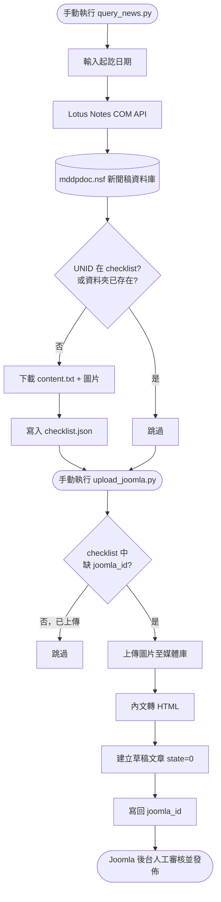

# SDD1 — 新聞稿自動上傳 Joomla

規格驅動開發文件。本文件回溯記錄「從 Lotus Notes 新聞稿資料庫擷取內容、自動上傳建立 Joomla 草稿文章」這項功能的現況規格，作為後續維護與技術債修正的基準，並標明此功能對 Joomla 正式站的影響面。

---

## 1. 背景與問題

院內新聞稿目前存放在 Lotus Notes 的 `mddpdoc.nsf`，對外官網（Joomla）需要人工手動搬運內容（複製文字、下載圖片、貼上、上傳圖片、排版）才能刊登，流程繁瑣且容易漏帶圖片或格式跑掉。本功能希望把「擷取 Notes 新聞稿」與「建立 Joomla 草稿文章」自動化，但**保留人工審核發佈**這一關，不讓程式直接把內容曝光到正式站。

## 2. 目標 / 非目標

**目標**
- 依日期區間從 `mddpdoc.nsf` 批次擷取新聞稿文字與內嵌圖片。
- 避免重複下載已抓過的文章。
- 把已下載但尚未上傳的文章，自動建立成 Joomla 草稿文章（含圖片），等待人工審核後發佈。
- 避免重複上傳同一篇文章。

**非目標（本階段不做）**
- 不自動發佈文章（`state` 固定為草稿 `0`，發佈永遠由人工在 Joomla 後台完成）。
- 不做排程自動執行（擷取需要互動輸入日期區間，且 Notes ID 目前沒開放非互動登入，`store/` 部署功能也有相同限制）。
- 不做 Joomla 端內容的更新／刪除同步（Notes 那邊如果事後改稿，不會回頭更新已上傳的 Joomla 草稿）。
- 不影響 Joomla 既有文章、分類、外掛設定——本功能只透過官方 REST API 新增內容，不碰資料庫、不改後台設定。

## 3. 使用者情境

> 我想幫某個月份的新聞稿建檔到官網。先執行 `query_news.py`，輸入起訖日期，程式會把這段期間所有新聞稿的文字和圖片抓下來存在本機資料夾，已經抓過的會自動跳過。接著執行 `upload_joomla.py`，程式會把還沒上傳過的文章逐篇建立成 Joomla 草稿（圖片也會一起上傳好放進內文），我最後只要進 Joomla 後台檢查排版、確認沒問題就按發佈。

## 4. 設計

### 4.1 新聞稿擷取（`query_news.py`）

| 項目 | 內容 |
|---|---|
| 資料來源 | Notes 伺服器 `mdaapa/medicine/Tzuchi`，資料庫 `OAuse\mddpdoc.nsf`，View「新聞稿」 |
| 篩選條件 | 文件 `fd_Date` 欄位落在使用者輸入的起訖日期區間內（含當天，結束日補到 23:59:59） |
| 輸出位置 | `OUTPUT_DIR`＝專案根目錄下的 `output/`（依腳本所在位置推算，已排除於 git 之外） |
| 輸出結構 | 每篇一個資料夾 `YYYYMMDD_標題前50字`，內含 `content.txt`（標題+分隔線+內文）與 `img_000.jpg`…（依 DXL 匯出解出的內嵌圖片，支援 jpeg/gif/png） |
| 去重機制 | 雙重比對：① UNID 是否已存在 `checklist.json` ② 對應資料夾是否已存在 `content.txt`，符合任一項即跳過（第②項會補登 checklist，避免資料夾在但清單漏記） |
| Checklist 欄位 | `date`／`subject`／`folder`／`chars`／`images`／`downloaded_at`（此階段還沒有 `joomla_id`） |

### 4.2 上傳 Joomla（`upload_joomla.py`）

| 項目 | 內容 |
|---|---|
| 待上傳判定 | `checklist.json` 中**沒有 `joomla_id`、也沒有 `joomla_skip` 欄位**的項目（`joomla_skip` 手動加在 checklist，值寫不上傳的原因，例如人醫心傳雜誌內容） |
| 查重 | 上傳前先用標題查官網（`filter[search]` 取標題最長一段搜尋，再比對去掉所有空白後的完整標題）；已有同標題文章（含人工上稿、已發佈）就只寫回 `joomla_id`＋`joomla_existing: true`，不上傳。查重 API 出錯時整篇略過，寧可不傳也不重複建立 |
| 標題整理 | `clean_title()`：去掉 Notes 標題開頭的日期編號（`17/`）與結尾作者括號（`(曾定嘉)`），比照人工上稿寫法；查重與建立文章都用整理後的標題 |
| `--dry-run` | 只做連線測試＋查重，列出每篇會怎麼處理，不上傳、不改 checklist |
| 連線前置檢查 | 執行一開始先 GET 一篇文章測試 `JOOMLA_URL` / `JOOMLA_TOKEN` 是否有效，失敗直接中止（不會半途污染資料） |
| 驗證方式 | Token 用 `X-Joomla-Token` 標頭送出，不用 `Authorization: Bearer`（網站 Apache 會把 `Authorization` 標頭吃掉，Joomla 收不到就回 401） |
| 圖片上傳 | Base64 編碼後 POST `/api/index.php/v1/media/files`，路徑規則 `{JOOMLA_MEDIA_FOLDER}/{年}/{月}/{月日}/{UNID前8碼}/img_NNN.ext`；送出時轉成 `local-images:/...`（`local-images` 根目錄即 `images/`，直接送 `images/...` 會存成 `images/images/...`，2026-10-12 實測後修正） |
| 內文轉換 | 讀 `content.txt`，跳過前 3 行（標題/分隔線/空行），先 `html.escape()` 再依空行分段包成 `
`，圖片網址附加於文末 |
| 建立文章 | POST `/api/index.php/v1/content/articles`，固定 `state=0`（草稿）、`catid` 取自 `.env` 的 `JOOMLA_CATEGORY_ID`、`publish_up` 設為新聞稿日期當天 08:00（格式必須是 `Y-m-d H:i:s`，用 ISO 的 `T` 分隔會讓 Joomla 寫 DB 時回 500，2026-10-12 實測） |
| 摘要圖片 | 第一張圖設為文章的「摘要圖片」（`images.image_intro`），格式比照人工上稿：`完整網址#joomlaImage://local-images/路徑?width=寬&height=高`（寬高取自 Media API 上傳回應）；全文圖片留空。沒有圖片的文章不設 |
| 完成標記 | 成功後把 `joomla_id`、`joomla_uploaded_at` 寫回 `checklist.json`，避免下次重複上傳 |
| 失敗處理 | 任一張圖片上傳失敗、或建立文章失敗，都不寫入 `joomla_id`，下次執行整篇重試（圖片以 `override` 覆蓋，不會重複） |

### 4.3 流程圖

## 5. 對 Joomla 正式站的影響面

這是專案中**唯一會直接寫入 Joomla 正式站資料庫**的功能（特約商店查詢頁只用 SCP 放靜態檔案，不經過 Joomla API）。影響範圍：
- 會新增 `articles`（草稿狀態）與 `media/files`（圖片）內容，不會修改或刪除任何既有內容。
- 依賴 Joomla 後台啟用 `webservices/content`、`webservices/media`、`api-authentication/token`、`user/token` 四個外掛（中文介面名稱為「網路服務 - 內容／媒體」「API 認證 - Joomla Token」「會員 - Joomla API Token」，2026-10-12 確認皆已啟用；Joomla 4/5 核心沒有 `System - Web Services` 外掛，舊版文件寫錯）。
- 依賴網站伺服器 `/etc/apache2/conf-available/security.conf` 的 API 白名單：2026/10 弱點修正時把 `/api/.../v1/` 全部封鎖（防 CVE-2023-23752），2026-10-12 改成只允許 `10.16.92.34`、且只能存取 `content/articles` 與 `media/files`。執行上傳的電腦 IP 一變就會回 403。
- 依賴網站伺服器 ModSecurity（OWASP CRS）對同一台電腦＋同兩支 API 的例外：文章內文含 HTML、中文 UTF-8，圖片是 base64，CRS 會誤判成 XSS/RCE（規則 941100/941160/941310/932130/932140）而擋下 403。伺服器另外擋 `DELETE` 方法（911100），API 無法刪檔。
- 任何對這支腳本的修改，都必須先在測試分類（`JOOMLA_CATEGORY_ID`）驗證過，不得直接對正式分類跑未測試過的版本。

## 6. 邊界情境

| 情境 | 現況行為 |
|---|---|
| `checklist.json` 不存在或為空 | 提示「請先執行 query_news.py」後結束，不報錯 |
| 沒有待上傳文章 | 印出「沒有待上傳的文章」後結束 |
| 找不到對應資料夾 | 印出錯誤、計入失敗數，略過該篇 |
| 部分圖片上傳失敗 | 該篇不建立文章、不標記，下次重跑（7.1 已解決） |
| 內文含 `<`、`>`、`&` 等 HTML 特殊字元 | 已用 `html.escape()` 跳脫（7.2 已解決） |
| Joomla API Token 失效 / 外掛未啟用 | 開頭連線測試會抓到並印出提示，直接 `exit(1)`，不會消耗任何一篇文章的上傳次數 |
| 同一篇文章重複執行上傳 | 已有 `joomla_id` 者會被排除，不會建立第二篇 |
| 官網已人工上稿過 | 查重找到同標題文章 → 只記 ID 不上傳（2026-10-12 實際遇到：09/17、09/18、09/21、09/23 四篇已在 9/29 人工上稿） |
| 人工上稿時改過標題 | **查不到**，會建立一篇重複的草稿（只比完整標題，避免誤判）；草稿不會出現在前台，審核時刪除即可 |

## 7. 已知問題 / 技術債

| # | 問題 | 影響 | 建議 |
|---|---|---|---|
| ~~7.1~~ | ~~單張圖片上傳失敗不會擋下文章建立~~ **已解決（2026-10-12）**：任一張失敗就不建立文章，下次整篇重跑 | — | — |
| ~~7.2~~ | ~~`text_to_html()` 未對內文做 HTML escape~~ **已解決（2026-10-12）** | — | — |
| ~~7.3~~ | ~~不會回頭核對 Joomla 現有文章~~ **已解決（2026-10-12）**：上傳前用標題查重（見 4.2「查重」），人工改過標題的仍查不到 | — | — |
| 7.4 | 只印在終端機，沒有落地 log 檔 | 中（無法排程、事後無法追查失敗原因） | 比照 `auto_checkin.py` 加 `checkin.log` 模式的 log 檔 |
| ~~7.5~~ | ~~`OUTPUT_DIR` 寫死成舊專案路徑 `autoRPA2-lotusNotesAPI\output`~~ **已解決（2026-09-23）**：換電腦後路徑失效，`query_news.py`／`upload_joomla.py` 已改成 `os.path.join(os.path.dirname(os.path.abspath(__file__)), "output")` | — | — |

## 8. 驗收標準

- [x] 依日期區間可從 `mddpdoc.nsf` 正確擷取文字與圖片，已下載的文章重跑會自動跳過
- [x] Joomla API 可從上傳電腦連線（2026-10-12：Apache 白名單 + `X-Joomla-Token` 後 GET 文章回 200；`config/application`、`users` 仍回 403）
- [x] 圖片可上傳到正確位置（2026-10-12 用測試圖驗證 `local-images:/` 路徑）
- [x] 完整跑過一次「擷取 → 上傳」流程，含圖片（2026-10-12：09/24～10/12 共 11 篇，查重擋下 6 篇已人工上稿、1 篇改過標題的手動對應，4 篇建立草稿 4706～4709 於分類 8，圖片網址皆 200）
- [ ] 至 Joomla 後台確認草稿排版
- [ ] 審核草稿後手動發佈，確認前台顯示正常
- [x] 確認重複執行 `upload_joomla.py` 不會建立重複文章（2026-10-12：四篇人工已上稿的文章被查重擋下，只記 ID）
- [x] 網站伺服器 ModSecurity 對上傳電腦＋兩支 API 設例外（2026-10-12：加在 `/etc/modsecurity/joomla-waf-rules.conf`，rule id 1000100，`ctl:ruleEngine=DetectionOnly`；`crs-exclusions.conf`／`crs-whitelist.conf` 沒被 `security2.conf` 載入，加在那裡無效）

> 目前狀態（2026-10-12）：**擷取與上傳都已實際跑通**，剩後台排版確認與手動發佈。注意人工上稿仍在進行，改過標題的文章查重比不到，上傳前建議先 `--dry-run` 看一下。上方「7. 已知問題」列出的技術債也建議在正式排上正式站前一併處理。

## 9. 待確認 / 後續可討論事項

- 是否要在真正排程自動化前，先手動穩定跑過幾輪，確認 Joomla API 沒有院內網路（自簽憑證、pfSense）造成的間歇性問題（`auto_checkin.py` 的 Portal 登入功能就曾遇過 SSL/ALPN 相容性問題，需要留意這裡是否也會遇到）。
- 7.1～7.4 的技術債要不要在下一輪開發直接處理，還是先維持現況、等真正要排程化時再補。
- 若未來評估 Joomla REST API 長期不穩定，可參考特約商店查詢頁「Notes → JSON → 靜態頁」的模式作為備案（但會犧牲現有的人工審核流程，需另外設計審核機制）。
